# INFORME CONSOLIDADO DE ANÁLISIS EXPLORATORIO DE DATOS (EDA)

**Proyecto:** Hackathon JFK Cooperativa Financiera 2026  

**Motor de Procesamiento:** Polars (Lazy Evaluation)  


---

# Informe EDA: `clientes.csv`

**Total de Registros:** `1,029,981`

## 1. Esquema de Datos y Tipos Detectados

| Columna | Tipo Inferido Polars | Categoría Asignada |
|---|---|---|
| `ID_ASOCIADO` | `String` | Identificador/Fecha |
| `ESTRATO` | `Int64` | Categórica |
| `RANGO_EDAD` | `String` | Categórica |
| `GENERO` | `String` | Categórica |
| `NIVEL_EDUCATIVO` | `Int64` | Categórica |
| `ESTADO_CIVIL` | `Int64` | Categórica |
| `PERSONAS_A_CARGO` | `Int64` | Numérica |
| `NUMERO_HIJOS` | `String` | Numérica |
| `TIPO_OCUPACION` | `Int64` | Identificador/Fecha |
| `ACTIVIDAD_CIIU` | `Int64` | Identificador/Fecha |
| `DECLARA_RENTA` | `Int64` | Categórica |
| `SEGMENTO` | `Int64` | Categórica |
| `ESTADO_ASOCIADO` | `Int64` | Categórica |
| `ANTIGUEDAD_MESES` | `Int64` | Numérica |
| `COMUNA_BARRIO` | `String` | Identificador/Fecha |
| `CODIGO_DANE` | `String` | Identificador/Fecha |


## 2. Resumen de Nulos

```
shape: (16, 3)
┌──────────────────┬──────────────┬─────────┐
│ Columna          ┆ Conteo_Nulos ┆ %_Nulos │
│ ---              ┆ ---          ┆ ---     │
│ str              ┆ u32          ┆ f64     │
╞══════════════════╪══════════════╪═════════╡
│ NUMERO_HIJOS     ┆ 1029981      ┆ 100.0   │
│ CODIGO_DANE      ┆ 1029981      ┆ 100.0   │
│ RANGO_EDAD       ┆ 18872        ┆ 1.83    │
│ COMUNA_BARRIO    ┆ 15128        ┆ 1.47    │
│ ESTRATO          ┆ 14165        ┆ 1.38    │
│ …                ┆ …            ┆ …       │
│ ID_ASOCIADO      ┆ 0            ┆ 0.0     │
│ GENERO           ┆ 0            ┆ 0.0     │
│ DECLARA_RENTA    ┆ 0            ┆ 0.0     │
│ ESTADO_ASOCIADO  ┆ 0            ┆ 0.0     │
│ ANTIGUEDAD_MESES ┆ 0            ┆ 0.0     │
└──────────────────┴──────────────┴─────────┘
```

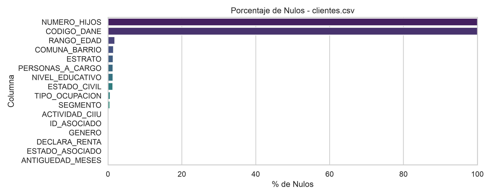

## 3. Distribuciones Categóricas Clave

## 4. Análisis Numérico y Outliers

```
shape: (9, 4)
┌────────────┬──────────────────┬──────────────┬──────────────────┐
│ statistic  ┆ PERSONAS_A_CARGO ┆ NUMERO_HIJOS ┆ ANTIGUEDAD_MESES │
│ ---        ┆ ---              ┆ ---          ┆ ---              │
│ str        ┆ f64              ┆ f64          ┆ f64              │
╞════════════╪══════════════════╪══════════════╪══════════════════╡
│ count      ┆ 1.016173e6       ┆ 0.0          ┆ 1.029981e6       │
│ null_count ┆ 13808.0          ┆ 1.029981e6   ┆ 0.0              │
│ mean       ┆ 0.695201         ┆ null         ┆ 142.836275       │
│ std        ┆ 0.955422         ┆ null         ┆ 101.45319        │
│ min        ┆ 0.0              ┆ null         ┆ -6.0             │
│ 25%        ┆ 0.0              ┆ null         ┆ 52.0             │
│ 50%        ┆ 0.0              ┆ null         ┆ 133.0            │
│ 75%        ┆ 1.0              ┆ null         ┆ 220.0            │
│ max        ┆ 46.0             ┆ null         ┆ 862.0            │
└────────────┴──────────────────┴──────────────┴──────────────────┘
```

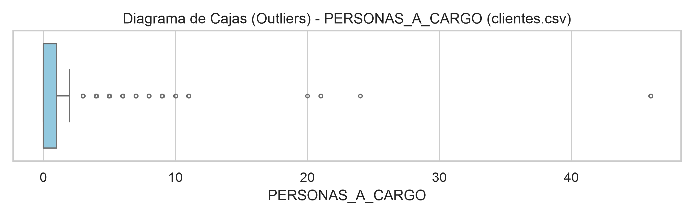

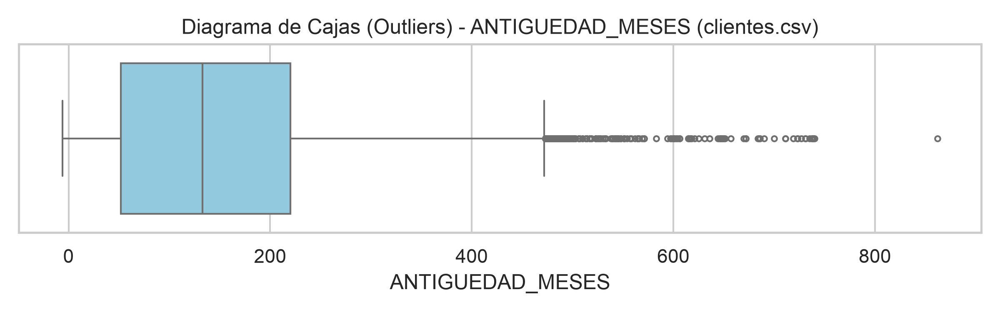

### Detección de Registros Anómalos / Centinela

```
shape: (6, 2)
┌────────────────────────────┬────────┐
│ Métrica                    ┆ Conteo │
│ ---                        ┆ ---    │
│ str                        ┆ u32    │
╞════════════════════════════╪════════╡
│ PERSONAS_A_CARGO_igual_999 ┆ 0      │
│ PERSONAS_A_CARGO_negativos ┆ 0      │
│ NUMERO_HIJOS_igual_999     ┆ 0      │
│ NUMERO_HIJOS_negativos     ┆ 0      │
│ ANTIGUEDAD_MESES_igual_999 ┆ 0      │
│ ANTIGUEDAD_MESES_negativos ┆ 28414  │
└────────────────────────────┴────────┘
```


---

# Informe EDA: `creditos.csv`

**Total de Registros:** `995,677`

## 1. Esquema de Datos y Tipos Detectados

| Columna | Tipo Inferido Polars | Categoría Asignada |
|---|---|---|
| `ID_CREDITO` | `String` | Identificador/Fecha |
| `ID_ASOCIADO` | `String` | Identificador/Fecha |
| `CLASE` | `Int64` | Categórica |
| `LINEA` | `Int64` | Categórica |
| `PLAZO` | `Int64` | Numérica |
| `TASA` | `Float64` | Numérica |
| `MONTO_DESEMBOLSO` | `Float64` | Numérica |
| `SALDO_CAPITAL` | `Float64` | Numérica |
| `VALOR_CUOTA` | `Float64` | Numérica |
| `GARANTIA` | `Int64` | Categórica |
| `FECHA_DESEMBOLSO` | `String` | Identificador/Fecha |
| `FECHA_ULT_MORA` | `String` | Identificador/Fecha |
| `FECHA_CANCELACION` | `String` | Identificador/Fecha |
| `ESTADO` | `Int64` | Categórica |


## 2. Resumen de Nulos

```
shape: (14, 3)
┌───────────────────┬──────────────┬─────────┐
│ Columna           ┆ Conteo_Nulos ┆ %_Nulos │
│ ---               ┆ ---          ┆ ---     │
│ str               ┆ u32          ┆ f64     │
╞═══════════════════╪══════════════╪═════════╡
│ FECHA_ULT_MORA    ┆ 964899       ┆ 96.91   │
│ FECHA_CANCELACION ┆ 109484       ┆ 11.0    │
│ ID_CREDITO        ┆ 0            ┆ 0.0     │
│ ID_ASOCIADO       ┆ 0            ┆ 0.0     │
│ CLASE             ┆ 0            ┆ 0.0     │
│ …                 ┆ …            ┆ …       │
│ SALDO_CAPITAL     ┆ 0            ┆ 0.0     │
│ VALOR_CUOTA       ┆ 0            ┆ 0.0     │
│ GARANTIA          ┆ 0            ┆ 0.0     │
│ FECHA_DESEMBOLSO  ┆ 0            ┆ 0.0     │
│ ESTADO            ┆ 0            ┆ 0.0     │
└───────────────────┴──────────────┴─────────┘
```

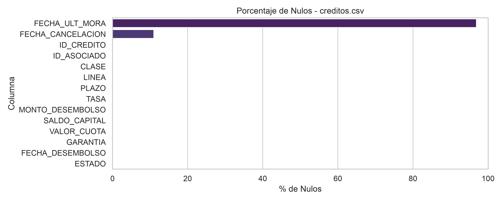

## 3. Distribuciones Categóricas Clave

## 4. Análisis Numérico y Outliers

```
shape: (9, 6)
┌────────────┬───────────┬──────────┬──────────────────┬───────────────┬───────────────┐
│ statistic  ┆ PLAZO     ┆ TASA     ┆ MONTO_DESEMBOLSO ┆ SALDO_CAPITAL ┆ VALOR_CUOTA   │
│ ---        ┆ ---       ┆ ---      ┆ ---              ┆ ---           ┆ ---           │
│ str        ┆ f64       ┆ f64      ┆ f64              ┆ f64           ┆ f64           │
╞════════════╪═══════════╪══════════╪══════════════════╪═══════════════╪═══════════════╡
│ count      ┆ 995677.0  ┆ 995677.0 ┆ 995677.0         ┆ 995677.0      ┆ 995677.0      │
│ null_count ┆ 0.0       ┆ 0.0      ┆ 0.0              ┆ 0.0           ┆ 0.0           │
│ mean       ┆ 41.444535 ┆ 0.000601 ┆ 8.0642e6         ┆ 1.2985e6      ┆ 253857.229601 │
│ std        ┆ 19.168406 ┆ 0.000773 ┆ 9.2649e6         ┆ 5.6428e6      ┆ 241971.364503 │
│ min        ┆ 1.0       ┆ 0.0      ┆ 0.0              ┆ 0.0           ┆ 0.0           │
│ 25%        ┆ 24.0      ┆ 0.000483 ┆ 2.5395e6         ┆ 0.0           ┆ 115234.89     │
│ 50%        ┆ 40.0      ┆ 0.000533 ┆ 5.2483e6         ┆ 0.0           ┆ 190096.81     │
│ 75%        ┆ 60.0      ┆ 0.00063  ┆ 1.0158e7         ┆ 0.0           ┆ 317460.36     │
│ max        ┆ 180.0     ┆ 0.019701 ┆ 5.815455e8       ┆ 5.6056e8      ┆ 8.54965e7     │
└────────────┴───────────┴──────────┴──────────────────┴───────────────┴───────────────┘
```

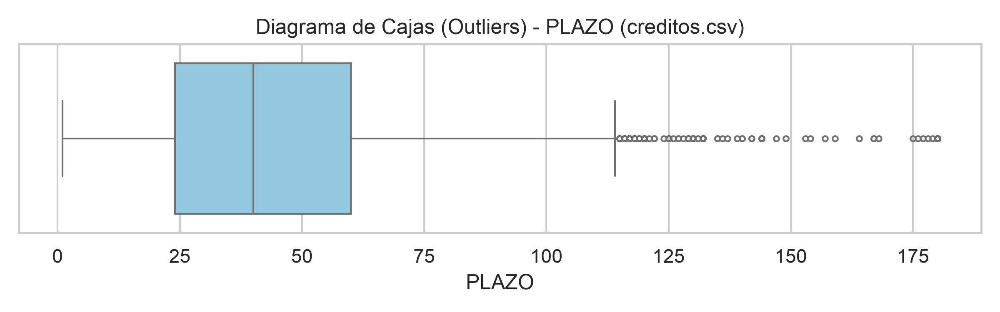

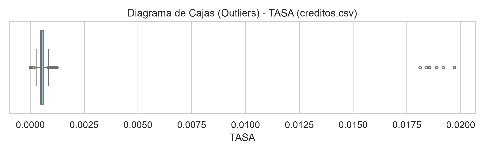

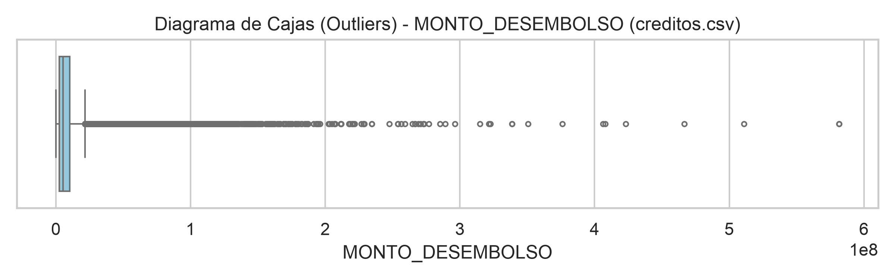

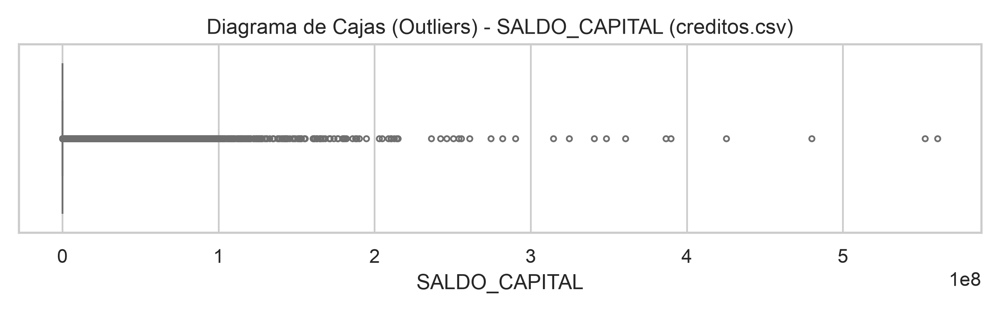

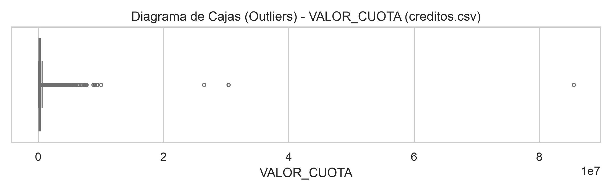

### Detección de Registros Anómalos / Centinela

```
shape: (10, 2)
┌────────────────────────────┬────────┐
│ Métrica                    ┆ Conteo │
│ ---                        ┆ ---    │
│ str                        ┆ u32    │
╞════════════════════════════╪════════╡
│ PLAZO_igual_999            ┆ 0      │
│ PLAZO_negativos            ┆ 0      │
│ TASA_igual_999             ┆ 0      │
│ TASA_negativos             ┆ 0      │
│ MONTO_DESEMBOLSO_igual_999 ┆ 0      │
│ MONTO_DESEMBOLSO_negativos ┆ 0      │
│ SALDO_CAPITAL_igual_999    ┆ 0      │
│ SALDO_CAPITAL_negativos    ┆ 0      │
│ VALOR_CUOTA_igual_999      ┆ 0      │
│ VALOR_CUOTA_negativos      ┆ 0      │
└────────────────────────────┴────────┘
```


---

# Informe EDA: `saldos.csv`

**Total de Registros:** `3,462,281`

## 1. Esquema de Datos y Tipos Detectados

| Columna | Tipo Inferido Polars | Categoría Asignada |
|---|---|---|
| `ID_CREDITO` | `String` | Identificador/Fecha |
| `FECHA_CORTE` | `String` | Categórica |
| `SALDO_CAPITAL` | `Float64` | Numérica |
| `DIAS_MORA` | `Int64` | Numérica |
| `CUOTAS_MORA` | `Int64` | Numérica |
| `CUOTAS_PAGAS` | `Int64` | Numérica |
| `INTERES_MORA` | `Float64` | Numérica |
| `GASTOS_COBRANZA` | `Float64` | Numérica |
| `ESTADO` | `Int64` | Categórica |


## 2. Resumen de Nulos

```
shape: (9, 3)
┌─────────────────┬──────────────┬─────────┐
│ Columna         ┆ Conteo_Nulos ┆ %_Nulos │
│ ---             ┆ ---          ┆ ---     │
│ str             ┆ u32          ┆ f64     │
╞═════════════════╪══════════════╪═════════╡
│ ID_CREDITO      ┆ 0            ┆ 0.0     │
│ FECHA_CORTE     ┆ 0            ┆ 0.0     │
│ SALDO_CAPITAL   ┆ 0            ┆ 0.0     │
│ DIAS_MORA       ┆ 0            ┆ 0.0     │
│ CUOTAS_MORA     ┆ 0            ┆ 0.0     │
│ CUOTAS_PAGAS    ┆ 0            ┆ 0.0     │
│ INTERES_MORA    ┆ 0            ┆ 0.0     │
│ GASTOS_COBRANZA ┆ 0            ┆ 0.0     │
│ ESTADO          ┆ 0            ┆ 0.0     │
└─────────────────┴──────────────┴─────────┘
```

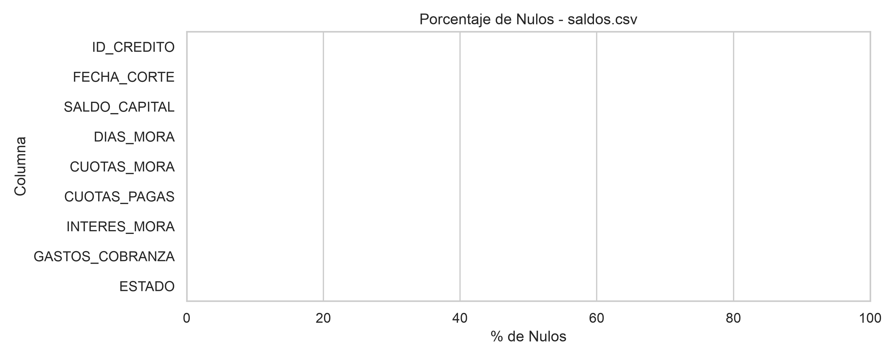

## 3. Distribuciones Categóricas Clave

## 4. Análisis Numérico y Outliers

```
shape: (9, 7)
┌────────────┬───────────────┬────────────┬─────────────┬──────────────┬───────────────┬─────────────────┐
│ statistic  ┆ SALDO_CAPITAL ┆ DIAS_MORA  ┆ CUOTAS_MORA ┆ CUOTAS_PAGAS ┆ INTERES_MORA  ┆ GASTOS_COBRANZA │
│ ---        ┆ ---           ┆ ---        ┆ ---         ┆ ---          ┆ ---           ┆ ---             │
│ str        ┆ f64           ┆ f64        ┆ f64         ┆ f64          ┆ f64           ┆ f64             │
╞════════════╪═══════════════╪════════════╪═════════════╪══════════════╪═══════════════╪═════════════════╡
│ count      ┆ 3.462281e6    ┆ 3.462281e6 ┆ 3.462281e6  ┆ 3.462281e6   ┆ 3.462281e6    ┆ 3.462281e6      │
│ null_count ┆ 0.0           ┆ 0.0        ┆ 0.0         ┆ 0.0          ┆ 0.0           ┆ 0.0             │
│ mean       ┆ 1.0864e7      ┆ 24.540017  ┆ 0.928489    ┆ 18.624266    ┆ 30222.214982  ┆ 0.006922        │
│ std        ┆ 1.1362e7      ┆ 104.954209 ┆ 3.138953    ┆ 16.483316    ┆ 307681.382299 ┆ 12.879736       │
│ min        ┆ 0.0           ┆ -53.0      ┆ 0.0         ┆ 0.0          ┆ 0.0           ┆ 0.0             │
│ 25%        ┆ 4016788.1     ┆ 0.0        ┆ 0.0         ┆ 5.0          ┆ 0.0           ┆ 0.0             │
│ 50%        ┆ 8.0132e6      ┆ 0.0        ┆ 0.0         ┆ 14.0         ┆ 0.0           ┆ 0.0             │
│ 75%        ┆ 1.413655e7    ┆ 0.0        ┆ 1.0         ┆ 29.0         ┆ 64.33         ┆ 0.0             │
│ max        ┆ 5.815455e8    ┆ 3786.0     ┆ 63.0        ┆ 180.0        ┆ 3.9050e7      ┆ 23965.59        │
└────────────┴───────────────┴────────────┴─────────────┴──────────────┴───────────────┴─────────────────┘
```

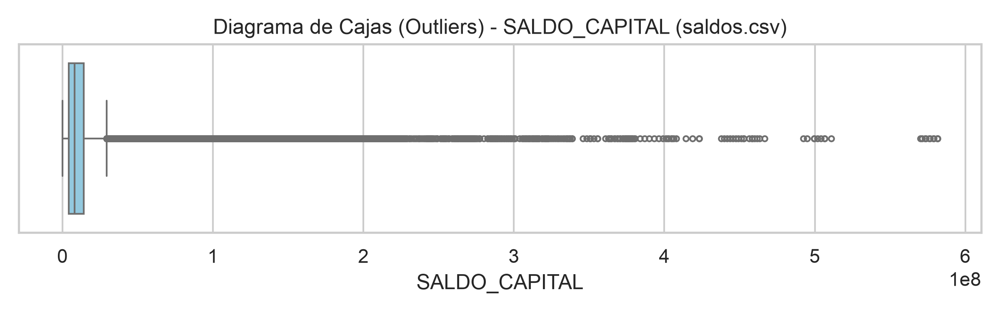

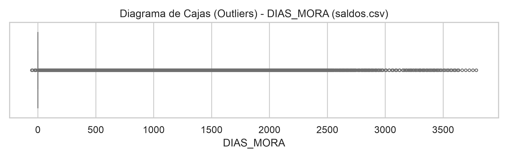

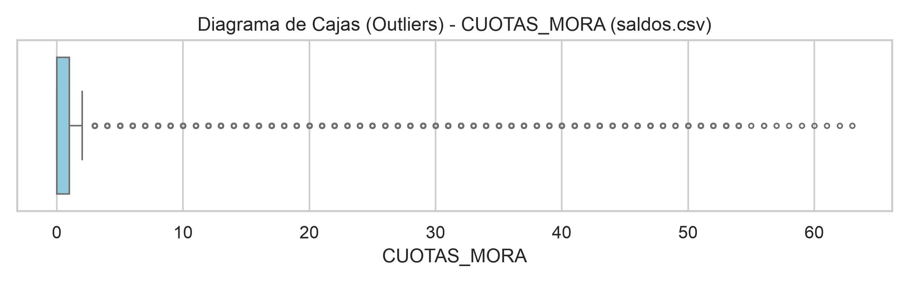

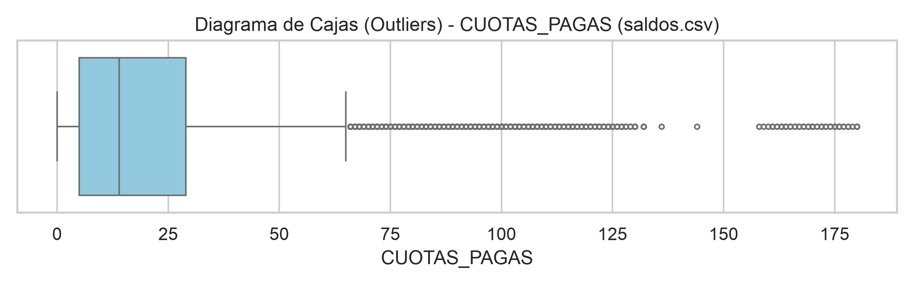

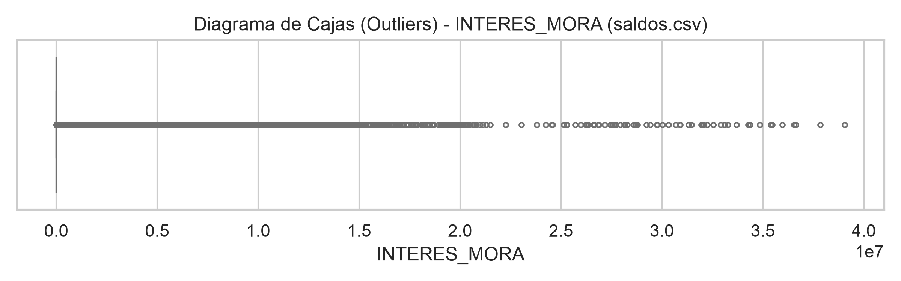

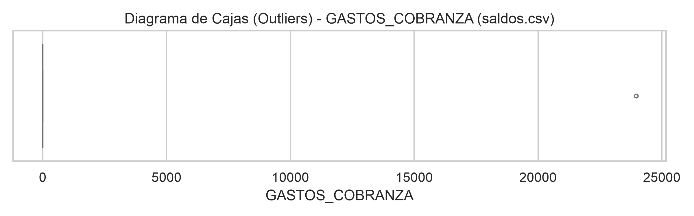

### Detección de Registros Anómalos / Centinela

```
shape: (12, 2)
┌───────────────────────────┬────────┐
│ Métrica                   ┆ Conteo │
│ ---                       ┆ ---    │
│ str                       ┆ u32    │
╞═══════════════════════════╪════════╡
│ SALDO_CAPITAL_igual_999   ┆ 0      │
│ SALDO_CAPITAL_negativos   ┆ 0      │
│ DIAS_MORA_igual_999       ┆ 11     │
│ DIAS_MORA_negativos       ┆ 6      │
│ CUOTAS_MORA_igual_999     ┆ 0      │
│ …                         ┆ …      │
│ CUOTAS_PAGAS_negativos    ┆ 0      │
│ INTERES_MORA_igual_999    ┆ 0      │
│ INTERES_MORA_negativos    ┆ 0      │
│ GASTOS_COBRANZA_igual_999 ┆ 0      │
│ GASTOS_COBRANZA_negativos ┆ 0      │
└───────────────────────────┴────────┘
```


---

# Informe EDA: `movimientos.csv`

**Total de Registros:** `3,395,995`

## 1. Esquema de Datos y Tipos Detectados

| Columna | Tipo Inferido Polars | Categoría Asignada |
|---|---|---|
| `ID_EVENTO` | `String` | Identificador/Fecha |
| `ID_CREDITO` | `String` | Identificador/Fecha |
| `FECHA` | `String` | Identificador/Fecha |
| `CODIGO_TRANSACCION` | `Int64` | Categórica |
| `NATURALEZA` | `Int64` | Categórica |
| `VALOR_CAPITAL` | `Float64` | Numérica |
| `VALOR_INTERES` | `Float64` | Numérica |
| `VALOR_MORA` | `Float64` | Numérica |
| `TASA_APLICADA` | `Float64` | Numérica |
| `CUOTA_APLICADA` | `Int64` | Numérica |


## 2. Resumen de Nulos

```
shape: (10, 3)
┌────────────────────┬──────────────┬─────────┐
│ Columna            ┆ Conteo_Nulos ┆ %_Nulos │
│ ---                ┆ ---          ┆ ---     │
│ str                ┆ u32          ┆ f64     │
╞════════════════════╪══════════════╪═════════╡
│ CUOTA_APLICADA     ┆ 7            ┆ 0.0     │
│ ID_EVENTO          ┆ 0            ┆ 0.0     │
│ ID_CREDITO         ┆ 0            ┆ 0.0     │
│ FECHA              ┆ 0            ┆ 0.0     │
│ CODIGO_TRANSACCION ┆ 0            ┆ 0.0     │
│ NATURALEZA         ┆ 0            ┆ 0.0     │
│ VALOR_CAPITAL      ┆ 0            ┆ 0.0     │
│ VALOR_INTERES      ┆ 0            ┆ 0.0     │
│ VALOR_MORA         ┆ 0            ┆ 0.0     │
│ TASA_APLICADA      ┆ 0            ┆ 0.0     │
└────────────────────┴──────────────┴─────────┘
```

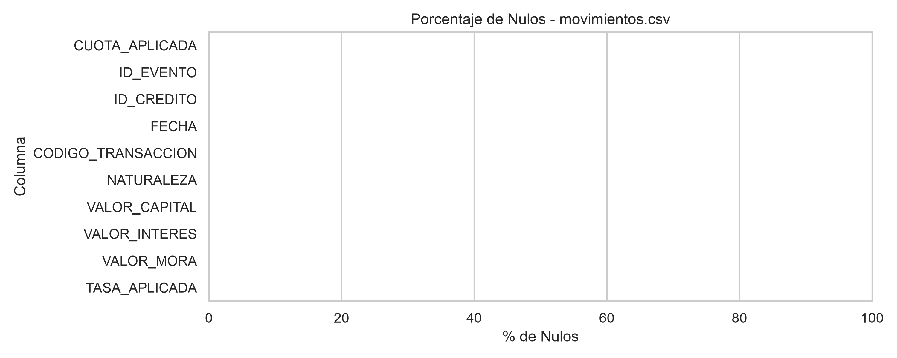

## 3. Distribuciones Categóricas Clave

## 4. Análisis Numérico y Outliers

```
shape: (9, 6)
┌────────────┬───────────────┬───────────────┬───────────────┬───────────────┬────────────────┐
│ statistic  ┆ VALOR_CAPITAL ┆ VALOR_INTERES ┆ VALOR_MORA    ┆ TASA_APLICADA ┆ CUOTA_APLICADA │
│ ---        ┆ ---           ┆ ---           ┆ ---           ┆ ---           ┆ ---            │
│ str        ┆ f64           ┆ f64           ┆ f64           ┆ f64           ┆ f64            │
╞════════════╪═══════════════╪═══════════════╪═══════════════╪═══════════════╪════════════════╡
│ count      ┆ 3.395995e6    ┆ 3.395995e6    ┆ 3.395995e6    ┆ 3.395995e6    ┆ 3.395988e6     │
│ null_count ┆ 0.0           ┆ 0.0           ┆ 0.0           ┆ 0.0           ┆ 7.0            │
│ mean       ┆ 994610.158587 ┆ 176590.463341 ┆ 6067.515438   ┆ 1.668943      ┆ 18.629422      │
│ std        ┆ 4.3901e6      ┆ 267913.195619 ┆ 113731.162552 ┆ 0.448849      ┆ 37.344851      │
│ min        ┆ 0.0           ┆ 0.0           ┆ 0.0           ┆ 0.0           ┆ 0.0            │
│ 25%        ┆ 132252.93     ┆ 52669.23      ┆ 0.0           ┆ 1.39          ┆ 5.0            │
│ 50%        ┆ 202555.6      ┆ 122166.88     ┆ 0.0           ┆ 1.69          ┆ 14.0           │
│ 75%        ┆ 319621.47     ┆ 228478.82     ┆ 1032.73       ┆ 1.890062      ┆ 29.0           │
│ max        ┆ 5.815455e8    ┆ 2.9459e7      ┆ 3.9529e7      ┆ 3.590001      ┆ 27601.0        │
└────────────┴───────────────┴───────────────┴───────────────┴───────────────┴────────────────┘
```

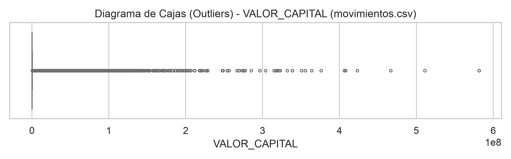

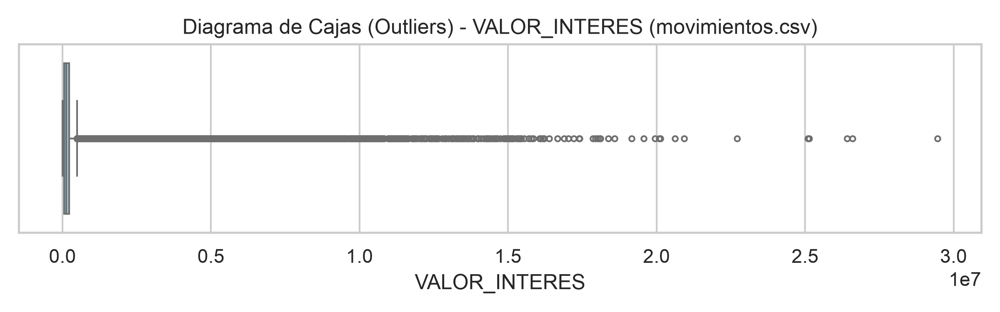

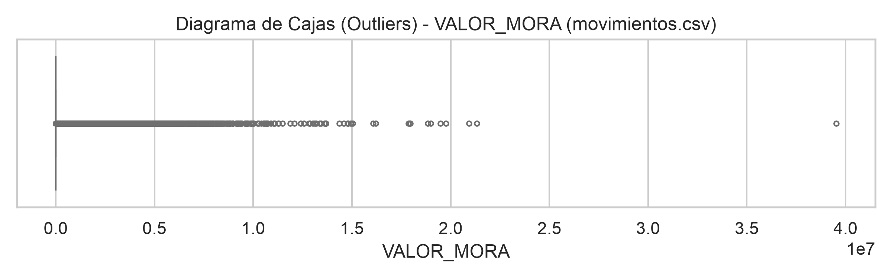

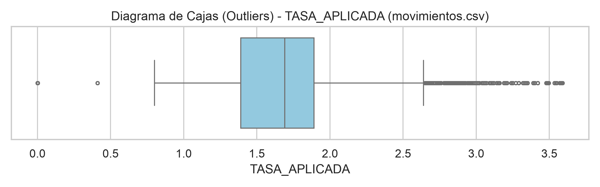

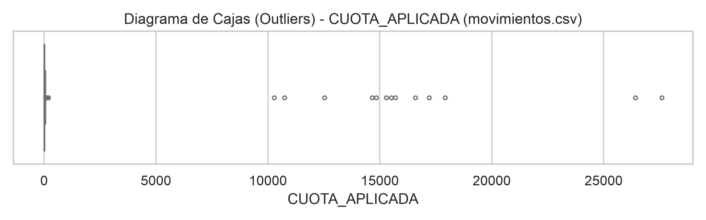

### Detección de Registros Anómalos / Centinela

```
shape: (10, 2)
┌──────────────────────────┬────────┐
│ Métrica                  ┆ Conteo │
│ ---                      ┆ ---    │
│ str                      ┆ u32    │
╞══════════════════════════╪════════╡
│ VALOR_CAPITAL_igual_999  ┆ 0      │
│ VALOR_CAPITAL_negativos  ┆ 0      │
│ VALOR_INTERES_igual_999  ┆ 0      │
│ VALOR_INTERES_negativos  ┆ 0      │
│ VALOR_MORA_igual_999     ┆ 0      │
│ VALOR_MORA_negativos     ┆ 0      │
│ TASA_APLICADA_igual_999  ┆ 0      │
│ TASA_APLICADA_negativos  ┆ 0      │
│ CUOTA_APLICADA_igual_999 ┆ 0      │
│ CUOTA_APLICADA_negativos ┆ 0      │
└──────────────────────────┴────────┘
```


---
